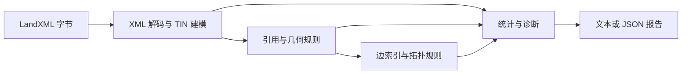

# MoonTIN 整体设计

## 使用场景与交付物

测绘人员提交 LandXML 地形文件，接收方运行 `moontin check survey.xml`，在导入设计软件前得到一份定位到曲面、测点和面的验收报告。首版交付 Mooncakes 可复用库、原生 CLI、可公开分发的测试样本与复现说明。

首版支持 UTF-8 编码的 LandXML 1.2、默认或前缀命名空间、单文件多个 `Surface`，以及每个 TIN 曲面的内联 `Pnts/P` 和 `Faces/F`。使用命名空间 URI 与元素本地名识别结构。未知的版本、非 TIN 曲面和无法验证的外部引用均明确报告。路线、管网、坐标系转换、自动修复和完整 XSD 校验留到后续版本。有效坐标按 Northing、Easting、Elevation 读取。报告保留坐标原单位，面积以原线性单位的平方计量。

- [俄勒冈州交通厅地形交接指南](https://www.oregon.gov/odot/EAST/Documents/TerrainExportImportUsingLandXML.pdf)
- [Autodesk LandXML 导入与坐标顺序](https://help.autodesk.com/cloudhelp/2023/ENU/Civil3D-UserGuide/files/GUID-4D10ABA5-5EA0-41A8-BB61-C3F446CE7C6B.htm)

## 数据流与模块

| 包 | 职责 | 生产 MoonBit LOC 预算 |
|---|---|---:|
| `model` | 曲面、测点、三角面、单位与位置模型 | 360 |
| `landxml` | XML 依赖适配、支持范围识别、逐曲面解码、输入限制 | 900 |
| `diagnostic` | 稳定规则码、定位、严重级别、输出顺序与截断状态 | 360 |
| `geometry` | 投影面积、包围盒、高程统计、容差与数值检查 | 540 |
| `topology` | 边索引、面去重、连通分量、边界及面方向 | 700 |
| `validate` | 规则调度、引用解析、跳过条件、统计聚合 | 700 |
| `report` | 文本与版本化 JSON 序列化 | 420 |
| `cmd/moontin` | 参数、文件读入、退出码及输出 | 420 |
| **生产代码合计** | **目标约 4,400 行** | **4,400** |

另计划约 1,600–2,100 行 MoonBit 测试。4,000 行以上以非测试、非生成的有效生产源码作为交付约束，排除空行、注释、生成接口、第三方源码和测试数据。用同一计数口径记录各阶段实际行数。若范围内实现低于目标，通过真实兼容性和验收需求补足，例如不可见面的统计分组或更细的边界诊断。

### 数据模型与接口

- `TerrainDocument` 保存版本、单位和文件顺序中的曲面列表。每个曲面有独立的点 ID 作用域。点 ID 按文本匹配，保留前导零。保留重复记录供规则定位两处声明。
- `Point` 保存明确定名的 `northing`、`easting`、`elevation`。`Face` 保存三个点 ID、曲面内从 1 开始的面序号及已知的可见性标记。
- `SourceRef` 优先提供曲面序号、名称、元素路径和记录序号。行列号随 XML 库实际能力提供。
- 库计划暴露 `parse`、`validate`、`check` 和报告类型。`parse` 提供结构化文档及可恢复诊断，`validate` 接收文档与选项。CLI 负责文件系统和进程退出码。包名与签名在初始化后用 `moon info` 核对。

### 规则与失败语义

| 阶段 | 规则与行为 |
|---|---|
| 文档 | XML 无法解析、格式版本不支持或没有可验收 TIN 时显式失败。可恢复的字段问题保留诊断，继续检查其他曲面。|
| 引用 | 检查空 ID、重复 ID、非有限坐标、面顶点数量错误、缺失或歧义引用、面内重复点。引用无效的面跳过几何与拓扑检查，计入跳过统计。|
| 几何 | 以 Easting/Northing 计算投影有向面积，检测共线和低于面积容差的三角面。先做局部坐标差，测试大坐标和非有限中间结果。容差可配置，报告记录生效值。|
| 拓扑 | 用规范化无向点对索引共享边，检测重复面、超过两个面的非流形边和共享边方向冲突。输出连通片及边界边数量。普通外边界和多个连通片可以是合法地形。|
| 可见性 | 首版对不可见面做结构和引用检查。几何、拓扑与面积统计默认以可见面为准，并在报告中记下排除数量。无效可见性值给出诊断。|

拓扑以通过前置检查的面为输入。每曲面使用点表、面键集合和边表，目标为按点与面数线性扫描，连通片使用带路径压缩的并查集。最终按曲面序号、记录序号和规则码稳定排序。首版允许整文件读入，文件字节数、记录数与输出诊断数设上限。XML 依赖选择前验证 DTD/外部实体处理和深度限制。诊断截断时仍统计错误和警告总数，并标记 `truncated`。

### CLI 与验收合同

- `moontin check terrain.xml [--format text|json] [--strict] [--area-tolerance N] [--max-diagnostics N]`
- 退出码 `0` 表示验收通过，`1` 表示存在验收错误或严格模式下存在警告，`2` 表示参数、I/O、XML 文档级解析失败或输入超出资源限制。检查报告写 stdout，运行错误写 stderr。
- JSON v1 至少包含 `schema_version`、`status`、曲面汇总、规则码、严重级别、位置、相关点 ID，以及诊断截断状态。同输入同配置输出一致。
- 样本覆盖一份正常 TIN、修改一个点引用的故障版、包含两个曲面的混合文件。演示从输入文件到定位报告，并验证 CLI 退出码和 JSON。
